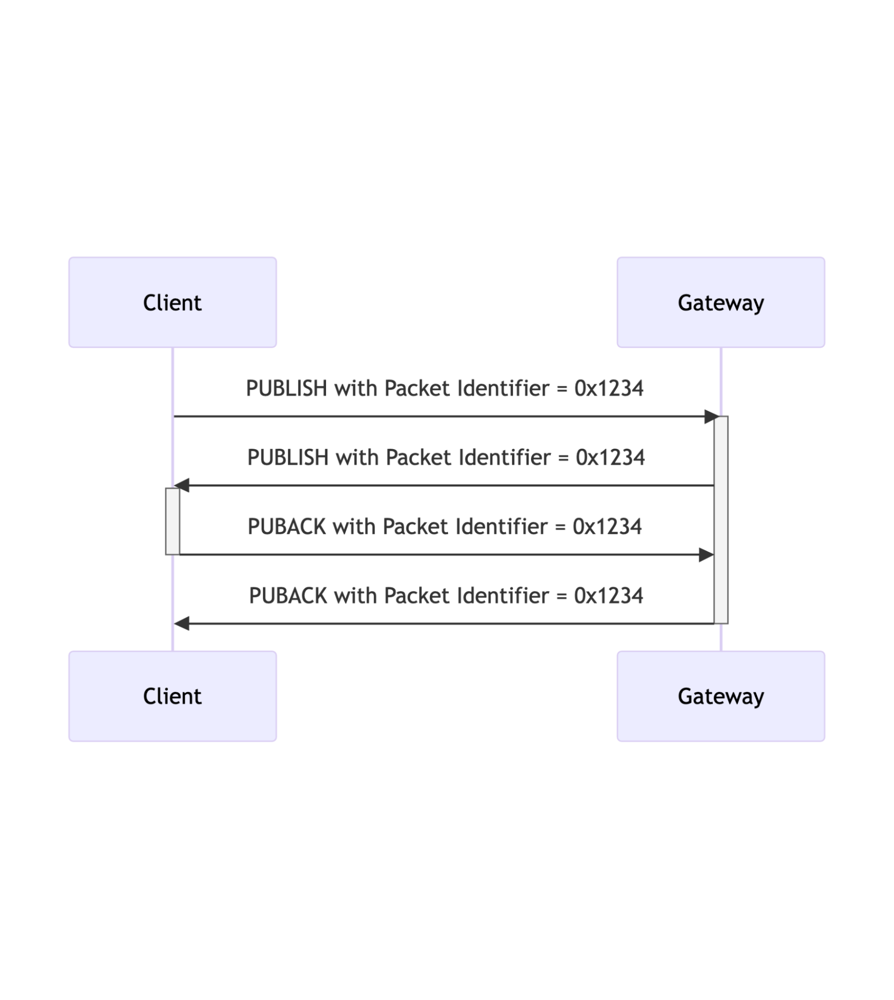

## Packet Identifier{#packet-identifier}

The Variable Header component of many of the MQTT-SN Control Packet types includes a Two Byte Integer Packet Identifier field. MQTT-SN Control Packets that require a Packet Identifier, along with the corresponding response Packet which all also require a Packet Identifier, are shown in [tab](#tab-packets-with-packet-identifier).

| MQTT-SN Control Packet   | Packet Identifier?      | Response Packet |
|:-------------------------|:------------------------|:----------------|
| ADVERTISE                | NO                      |                 |
| AUTH                     | YES                     | AUTH, CONNACK   |
| CONNECT                  | YES                     | AUTH, CONNACK   |
| DISCONNECT               | OPTIONAL                |                 |
| FORWARDER ENCAPSULATION  | NO                      |                 |
| GWINFO                   | NO                      |                 |
| PINGREQ                  | YES                     | PINGRESP        |
| PROTECTION ENCAPSULATION | NO                      |                 |
| PUBLISH - QoS 0          | NO                      |                 |
| PUBLISH - QoS 1          | YES                     | PUBACK          |
| PUBLISH - QoS 2          | YES                     | PUBREC          |
| PUBREL                   | YES                     | PUBCOMP         |
| PUBWOS                   | NO                      |                 |
| REGISTER                 | YES                     | REGACK          |
| SEARCHGW                 | NO                      |                 |
| SLEEPREQ                 | YES                     | SLEEPRESP       |
| SUBSCRIBE                | YES                     | SUBACK          |
| UNSUBSCRIBE              | YES                     | UNSUBACK        |
| WAKEUP                   | NO                      |                 |

Table: Packets with Packet Identifier{#tab-packets-with-packet-identifier}

«<mark title="Requirement MQTT-SN-2.2-1">Each time a Client sends a new MQTT-SN Control Packet which is identified in [tab](#tab-packets-with-packet-identifier) as requiring a Packet Identifier, it MUST assign it a non-zero Packet Identifier that is currently unused</mark>»[MQTT‑SN‑2.2‑1](#tab-MQTT-SN-2.2-1).

«<mark title="Requirement MQTT-SN-2.2-2">A PUBLISH packet MUST NOT contain a Packet Identifier if its QoS value is set to 0</mark>»[MQTT‑SN‑2.2‑2](#tab-MQTT-SN-2.2-2).

«<mark title="Requirement MQTT-SN-2.2-3">Each time a Server sends a new PUBLISH (with QoS greater than 0) MQTT-SN Control Packet it MUST assign it a non zero Packet Identifier that is currently unused</mark>»[MQTT‑SN‑2.2‑3](#tab-MQTT-SN-2.2-3).

Packet Identifiers in all packets which require one (as shown in [tab](#tab-packets-with-packet-identifier)), including response packets, form a single, unified set of identifiers separately for the Client and the Server in a Session. 

The Packet Identifier becomes available for reuse after the sender has processed the corresponding response packet, as shown in [tab](#tab-packets-with-packet-identifier), except for the case of PUBLISH QoS 2, where it is either a PUBCOMP or a PUBREC with a Reason Code of 0x80 or greater.

«<mark title="Requirement MQTT-SN-2.2-4">A response packet MUST contain the same Packet Identifier as the Packet that it is responding to</mark>»[MQTT‑SN‑2.2‑4](#tab-MQTT-SN-2.2-4).

The Client and Server assign Packet Identifiers independently of each other. As a result, Client-Server pairs can participate in concurrent Packet exchanges using the same Packet Identifiers.

> **Informative comment**
>
> It is possible for a Client to send a PUBLISH packet with Packet Identifier 0x1234 and then receive a different PUBLISH packet with Packet Identifier 0x1234 from its Server before it receives a PUBACK for the PUBLISH packet that it sent.

{#fig-publishes-with-the-same-packet-identifier}
