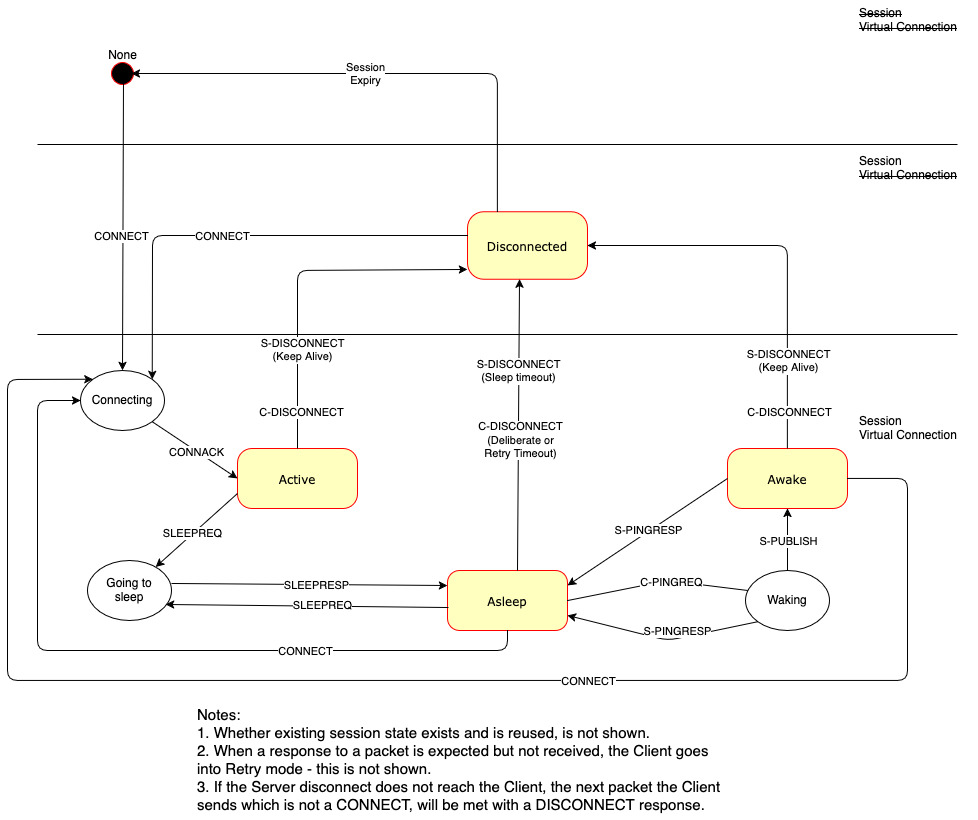
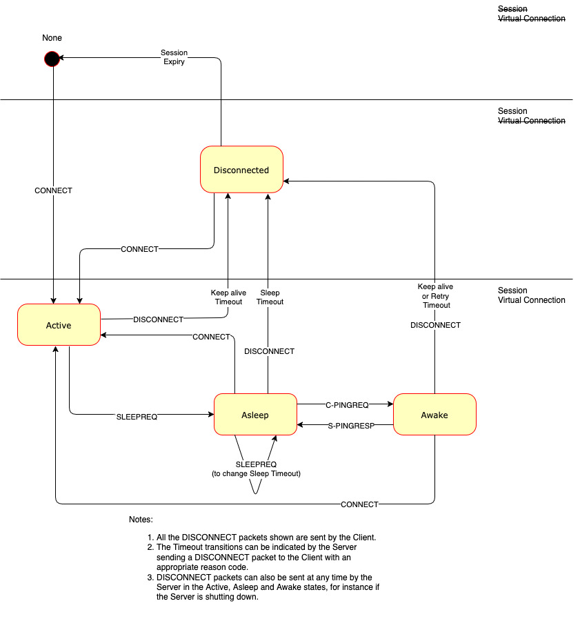

## C.5 Client State Diagrams{#c.5-client-state-diagrams}

The following diagrams are illustrative, graphical views of the states and transitions. They are not comprehensive but included for guidance.

{#fig-server-view-of-client-states-informative}

{#fig-server-view-of-client-states-informative-2}

<!-- These two figures both contained image27.jpg which was identical with ServerState.jpg -->
<!-- TODO: Is this a doubled figure and we did not want to show the ClientState.jpg or ...? -->
