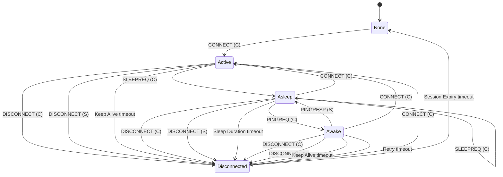

# Server view of Client states

Derived from records/states/server-view.yaml. States: tab-client-states; timers: tab-session-timers.

| From | To | Trigger | Note |
|:-----|:---|:--------|:-----|
| None | Active | CONNECT from the client |  |
| Disconnected | Active | CONNECT from the client |  |
| Disconnected | None | Session Expiry timer |  |
| Active | Disconnected | DISCONNECT from the client |  |
| Active | Disconnected | DISCONNECT from the server | figure note 3 |
| Active | Disconnected | Keep Alive timer |  |
| Active | Asleep | SLEEPREQ from the client |  |
| Asleep | Asleep | SLEEPREQ from the client | to change the Sleep Duration |
| Asleep | Active | CONNECT from the client |  |
| Asleep | Awake | PINGREQ from the client |  |
| Asleep | Disconnected | DISCONNECT from the client |  |
| Asleep | Disconnected | DISCONNECT from the server | figure note 3 |
| Asleep | Disconnected | Sleep Duration timer |  |
| Awake | Asleep | PINGRESP from the server |  |
| Awake | Active | CONNECT from the client |  |
| Awake | Disconnected | DISCONNECT from the client |  |
| Awake | Disconnected | DISCONNECT from the server | figure note 3 |
| Awake | Disconnected | Keep Alive timer |  |
| Awake | Disconnected | Retry timer |  |

## What a Client may send

- Asleep: PINGREQ, CONNECT, DISCONNECT (MQTT-SN-4.14-2: In the Asleep state, a Client MUST only send PINGREQ, CONNECT or DISCONNECT packets to the Server)
- Awake: PUBACK, PUBREC, PUBCOMP, REGACK, CONNECT, DISCONNECT (MQTT-SN-4.14-3: In the Awake state, a Client MUST not send ANY packets other than those involved in the receipt of PUBLISH packets (PUBACK, PUBREC, PUBCOMP, REGACK) or CONNECT or DISCONNECT)
